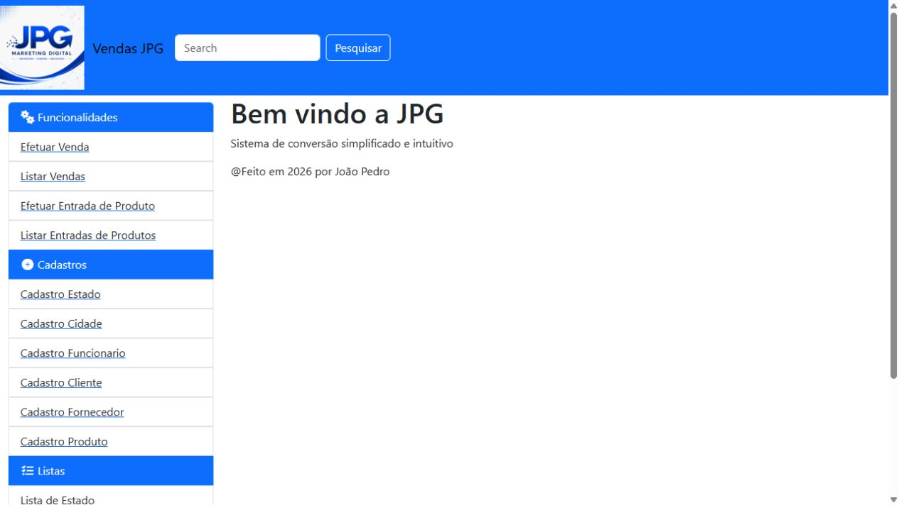
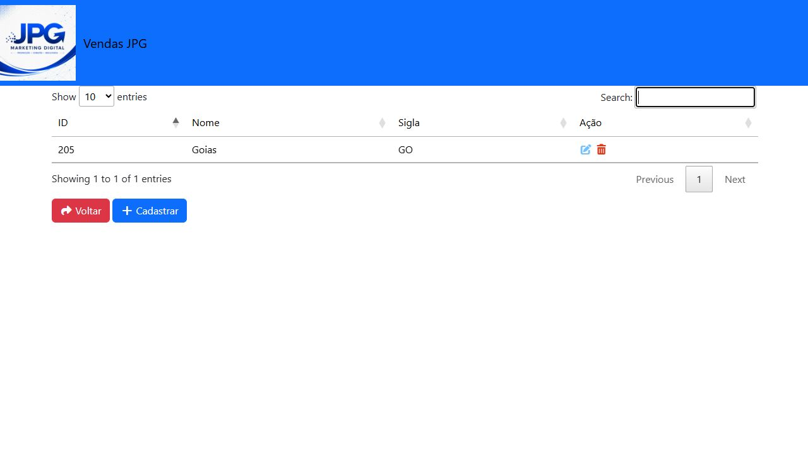
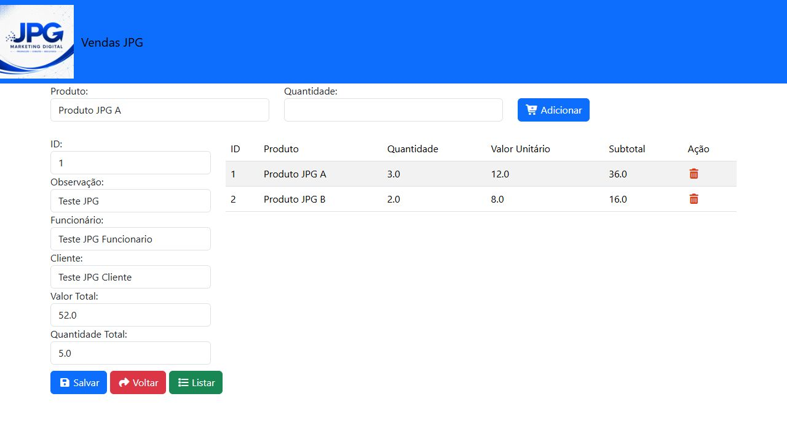

# Sistema de Vendas JPG

Sistema web de vendas desenvolvido como projeto de estudo, com a identidade visual da **JPG Marketing Digital**. Reúne cadastros, entrada de produtos e registro de vendas, com persistência em PostgreSQL e atualização de estoque.



## Funcionalidades

| Módulo | Recursos |
| --- | --- |
| Estados e cidades | Cadastro, listagem, edição e relacionamento entre cidade e estado |
| Funcionários, clientes e fornecedores | Cadastros com endereço, cidade e máscaras de documentos e telefone |
| Produtos | Código de barras, unidade de medida, estoque, custo, venda, lucro e margem |
| Entradas | Seleção de fornecedor e funcionário, inclusão de itens e atualização de estoque e preços |
| Vendas | Seleção de cliente e funcionário, preço obtido do produto, subtotais, total e baixa de estoque |
| Listagens | Busca, ordenação e paginação com DataTables |

## Tecnologias e organização

- Java, Spring Boot 4.1.1 e Spring MVC.
- Spring Data JPA / Hibernate e PostgreSQL.
- Thymeleaf, Bootstrap, Font Awesome, jQuery e DataTables.
- Maven Wrapper e Eclipse como ambiente de desenvolvimento.

O projeto separa os controles de navegação e gravação (`controle`), as entidades e repositórios (`modelos`) e as páginas Thymeleaf (`resources/templates`). As relações entre as entidades são descritas em [Modelo de dados](docs/modelo-de-dados.md).

## Telas

### Consulta de estados



### Registro de venda



## Como executar

### Requisitos

- JDK 25 e PostgreSQL 18 foram utilizados na verificação local. O `pom.xml` define Java 17 como alvo de compilação.
- Uma instalação do PostgreSQL com acesso local. Não é necessário instalar o Maven separadamente.

### 1. Obter o projeto

```bash
git clone https://github.com/Jpgoncalvesz/sistema-vendas-jpg.git
cd sistema-vendas-jpg
```

### 2. Criar o banco

No pgAdmin ou no terminal SQL, execute uma vez:

```sql
CREATE DATABASE loja;
```

As tabelas e os relacionamentos são criados/atualizados pelo Hibernate ao iniciar a aplicação. O repositório não contém registros exportados do banco.

### 3. Configurar o acesso

Copie `database-local.properties.example` para `database-local.properties` na raiz do projeto e informe as credenciais do seu PostgreSQL. Esse arquivo local é ignorado pelo Git.

Também é possível configurar por variáveis de ambiente:

```powershell
$env:DB_URL="jdbc:postgresql://localhost:5432/loja"
$env:DB_USERNAME="postgres"
$env:DB_PASSWORD="SUA_SENHA_LOCAL"
```

As variáveis de ambiente têm prioridade sobre o arquivo local.

### 4. Iniciar

Windows:

```powershell
.\mvnw.cmd spring-boot:run
```

Linux/macOS:

```bash
chmod +x mvnw
./mvnw spring-boot:run
```

Acesse **http://localhost:8088/administrativo**. Comece cadastrando um estado e uma cidade; depois cadastre funcionário, cliente, fornecedor e produto para usar entradas e vendas.

No Eclipse, importe como **Existing Maven Project** e execute `SistemaApplication` como Java Application, usando a pasta do projeto como diretório de trabalho.

### Verificação

Com o PostgreSQL configurado:

```powershell
.\mvnw.cmd verify
```

O teste automatizado incluído no projeto verifica a inicialização do contexto Spring. Durante o desenvolvimento, também foram verificados separadamente 16 endpoints de cadastro/listagem e um fluxo de entrada e venda com dois produtos, conferindo totais, subtotais e estoque em um esquema temporário. Essa verificação de fluxo não faz parte da suíte automatizada deste repositório.

O workflow em [`.github/workflows/build.yml`](.github/workflows/build.yml) executa o Maven com um PostgreSQL temporário no GitHub Actions.

## Estágio do projeto

Projeto de aprendizagem correspondente ao conteúdo apresentado até a aula 17 da playlist de referência. Há limitações mantidas nessa etapa:

- Exclusão de itens de entrada/venda ainda não concluída.
- Edição de movimentações sem um fluxo completo de estorno e recomposição de estoque.
- Sem autenticação e controle de permissões.
- Pesquisa do cabeçalho ainda sem implementação.
- Lista temporária de itens mantida no controlador, sem isolamento por sessão de usuário.
- Validações e tratamento de erros ainda básicos; valores monetários utilizam `Double`, conforme a abordagem das aulas.

Esses pontos fazem parte da evolução futura do estudo; não há demonstração pública com banco compartilhado.

## Créditos e aprendizado

Desenvolvido por **João Pedro Gonçalves Máximo**, com identidade visual JPG, a partir da playlist [Criando Sistema de Vendas com Java, Spring, Bootstrap e postgres — Tecnum](https://www.youtube.com/playlist?list=PLVRaNlAwjZBu9QARSthAFIjQeXVVT-61B).

A implementação foi acompanhada e adaptada com auxílio de IA, preservando a proposta didática das aulas. A preparação para o GitHub acrescenta documentação, imagens, configuração externa do banco e um workflow de verificação. Este repositório apresenta a prática de relacionamentos JPA, formulários Thymeleaf e operações de entrada e venda.
