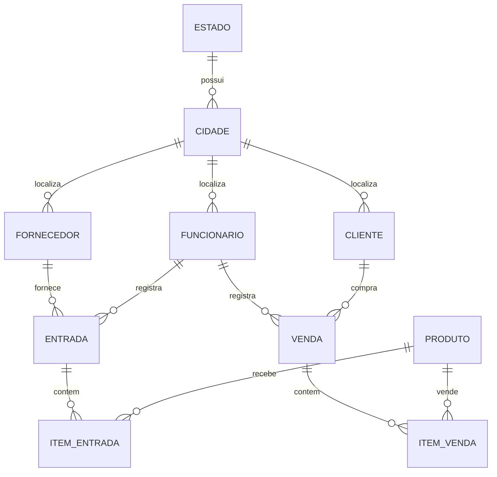

# Modelo de dados

O Hibernate mapeia as entidades Java para tabelas PostgreSQL. Cada item de entrada ou venda referencia um produto e sua movimentação.

As associações são definidas com `@ManyToOne`. Os identificadores usam `@GeneratedValue(strategy = GenerationType.AUTO)`.

## Fluxo de entrada

1. Selecionar produto, quantidade, custo e preço de venda.
2. Adicionar o item à lista temporária e atualizar os totais.
3. Salvar a entrada e seus itens.
4. Acrescentar as quantidades ao estoque e atualizar os preços do produto.

## Fluxo de venda

1. Selecionar produto e quantidade.
2. Obter o preço de venda do produto e calcular o subtotal.
3. Salvar a venda e seus itens.
4. Subtrair do estoque as quantidades vendidas.

O comportamento atual segue o recorte didático da playlist, incluindo as limitações de edição e estorno descritas no README.
